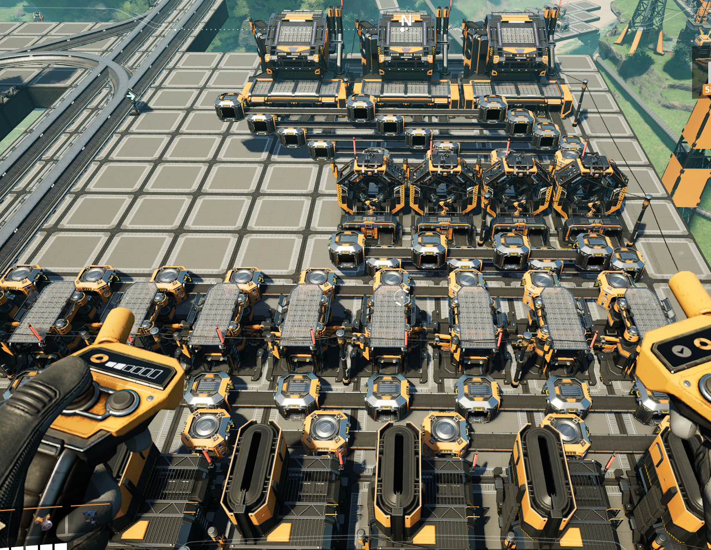

# Factory Spawner

https://ficsit.app/mod/FactorySpawner

**Version 2.3.0 - Satisfactory 1.2 compatibility update (2026-06-15)**

- 🔧 Updated for Satisfactory 1.2 / SML 3.12 (Unreal Engine 5.6)

**Version 2.2.0 - Release (2025-12-24)**

**License:** [MIT](LICENSE)

## 🎉 What's New

- ⚡ **Power generators added** — Coal Generator, Fuel Generator, Nuclear Power Plant.
- 📝 **Display name support** — Type recipes as shown in-game (e.g., "IronIngot" instead of "IngotIron"). But both work.

## From Version 2.1.0

- 🆕 **Conveyor lifts added** — Adds more compact vertical designs; lift tier matches belt tier.
- 🏭 **Added remaining production machines** — Packager, Converter, Particle Accelerator, Quantum Encoder.

## From Version 2.0.0

- 🔥 **Blueprint generation via chat commands** - No more schematics or recipes needed!
- 🔄 **Automatic belt tier detection** - Uses your highest unlocked belt tier (Mk1-Mk6)
- 💧 **Automatic pipeline tier** - Automatically uses Mk2 pipes when unlocked
- ⚙️ **Optional belt tier override** - Force a specific belt tier with `beltTier {number}`

---

**Factory Spawner** takes the hassle out of manually placing and wiring every machine.  
Simply tell it what you want to produce and how many machines you need, and it will:

- ✅ Spawn the requested machines and set their recipes
- 🔄 Automatically connect everything with belts
- ⚡ Wire up power poles and connect them to the grid
- 🛠️ Handle splitters, mergers, and constructors for smooth production chains

---

# Usage

## Quick Start

Open the chat and type your factory command, e. g.

```bash
/FactorySpawner 2 Smelter IngotIron, 3 Constructor IronPlate
```

A blueprint called "FactorySpawner" will be created. Just place it!



## Command Syntax

```bash
/FactorySpawner {number} {machine type} {recipe} {underclock}
```

(without curly braces)

- **number** → Number of machines in a row
- **machine type** → Smelter, Constructor, Assembler, Foundry, Manufacturer, Refinery, Blender, Packager, Converter, ParticleAccelerator, QuantumEncoder, CoalGenerator, FuelGenerator, NuclearReactor
- **recipe** (optional) → e.g. IngotIron, IronPlate, Motor, Computer
- **underclock** (optional) → The clock speed of each machine in the row (Value in %: 0 - 100)

You can chain multiple commands, separated by commas. Each creates a new row of machines:

```bash
/FactorySpawner {number 1} {machine type 1} {recipe 1}, {number 2} {machine type 2} {recipe 2}
```

---

# Examples

This spawns **2 Smelters** making Iron Ingots and **3 Constructors** making Iron Plates, all connected with belts and power:

```bash
/FactorySpawner 2 Smelter IngotIron, 3 Constructor IronPlate
```

Here is the config from the screenshot (without recipes).

```bash
/FactorySpawner 12 Smelter, 10 Constructor, 5 Foundry, 10 Constructor, 4 Assembler, 3 Manufacturer
```

## Production planner

Use `plan` to preview inputs, outputs and estimated machine power. Use `build` to create the blueprint.

```text
/FactorySpawner plan IronPlateReinforced=5
/FactorySpawner build Motor=20, Stator=10, import SteelPipe, floorHeight 40
/FactorySpawner build Plastic=20, export HeavyOilResidue
/FactorySpawner plan SpaceElevatorPart_12=1
```

Targets and interfaces use units/min for solid items or m³/min for fluids. Names can be localized display names or internal identifiers. For example, the AI Expansion Server can also be requested as `SpaceElevatorPart_12=1`. Use comma-separated settings:

- `import Item` uses an external supply of that item.
- `recipe Item=RecipeName` chooses a specific unlocked recipe for an item.
- `export Item` exports production of that item as a byproduct instead of using it inside the factory.
- `floor RecipeName=3` sets the floor of a recipe.
- `floorHeight 48` sets the minimum floor spacing in metres for a production plan. `beltTier 5` selects the belt and lift tier.

The planner works from unlocked recipes and shares upstream production between targets. It packs machine rows into parallel bands, groups machines taller than 12 m on one equipment floor, and rounds each deck spacing up to the next metre after leaving 1.5 m of clearance below the next foundation. An explicit `floor` assignment takes priority. Surplus byproducts get labeled outlets. If a closed recycling loop cannot start with the available inputs, the planner reports the missing starter supply. Use `import` to feed that material from outside.

The `build` command saves a blueprint named `FactorySpawner` in the current game session. Each successful build replaces that named blueprint. Rename it in the game if you want to keep multiple designs. After placing it, connect the labeled material inputs and the `FACTORY POWER IN` pole. Solid inputs and outlets are arranged along the ground-level sides near their production rows. Pipe ports are grouped at the front. Supply liquids with enough pressure and keep product and byproduct outlets clear.

## Multi-floor Blueprints

Add `floor=N` after a row's recipe and optional clock speed. Floors are numbered 1–8 and rows without a floor use floor 1.

```text
/FactorySpawner 2 Smelter IngotIron floor=1, 3 Constructor IronPlate floor=2, beltTier 3
```

The rows on each floor share an 8 m foundation grid. For explicit machine-row commands, floors are 32 m apart by default. Add a comma-separated `floorHeight 48` setting to set the spacing in metres (16–64 m). Higher floors can be entered before lower floors when the recipe needs a downward conveyor.

In a multi-floor blueprint, each identified solid ingredient can be connected to an unused matching output from the nearest earlier row. Each output serves one input. Horizontal belts link the layouts on the same floor and feed lift sections outside the platforms for cross-floor routes. Any unpaired or unidentified ports stay available for external connections. Fluid pipes are built within their rows.

## Automatic Tier Selection

The mod **automatically detects and uses your highest unlocked belt and pipeline tiers**!

- 🔄 **Belts**: Uses Mk1-Mk6 based on what you've unlocked
- 💧 **Pipelines**: Automatically uses Mk2 pipelines if available

You can also override the belt tier:

```bash
/FactorySpawner 2 Smelter IngotIron, 3 Constructor IronPlate, beltTier 3
```

This forces the mod to use **Mk3 belts** instead of auto-detection.

---

# ⚡ Automatically Generate Commands

👉 [**Open Satisfactory Planner**](https://uniquesimon.github.io/satisfactory-planner/)

With this tool you can **plan your factories online** and instantly generate a **config command string**.  
No manual typing required — just:

1. Design your factory setup in the planner.  
2. Copy the generated config string to your clipboard.  
3. Paste it directly into the in-game chat (`Ctrl + V`).  

Your factory will be ready in seconds! 🚀

# Safe to Uninstall

All placed buildables are just **vanilla ones**, so you can safely uninstall the mod at any time.

# Known Issues

- You can spawn machines that have not yet been unlocked.

# Feedback on Discord

<https://discord.gg/Yzgw9yQK>

# 💛 Donation

Your support means a lot and helps me keep creating awesome stuff for *Satisfactory*!

☕ [Donate via PayPal](https://www.paypal.com/donate/?hosted_button_id=883ATSZP7JLPS)

Totally optional — but very appreciated!
